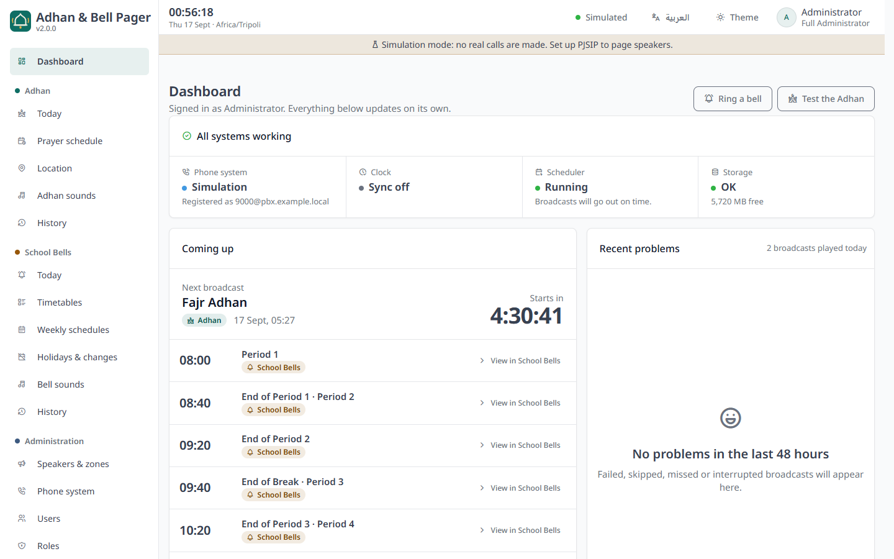
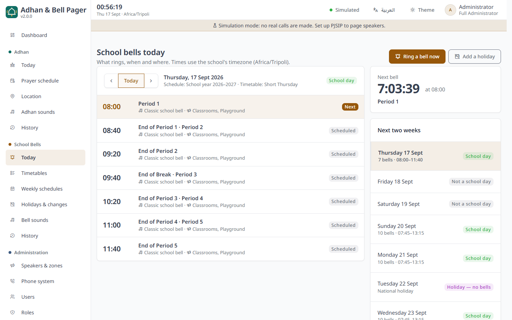
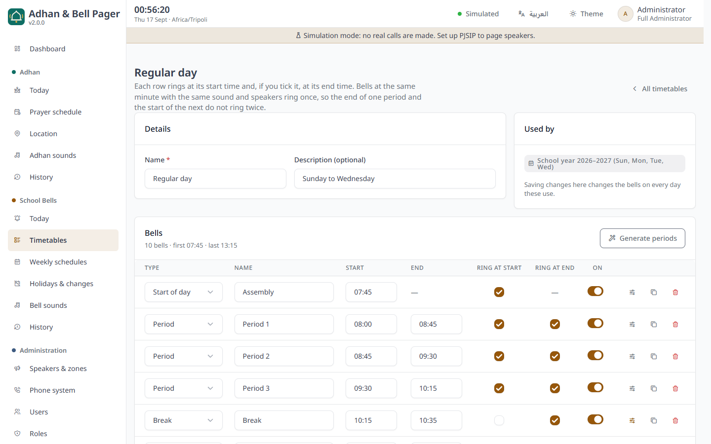
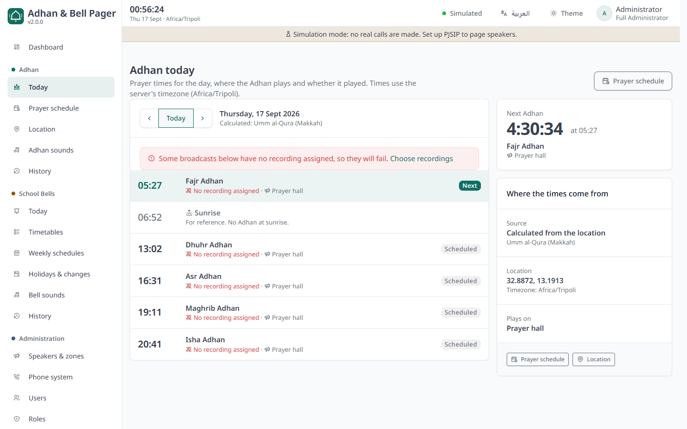
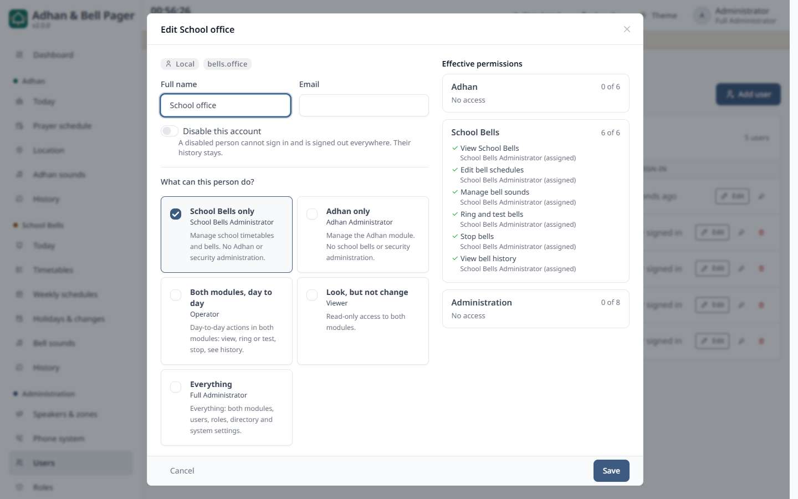
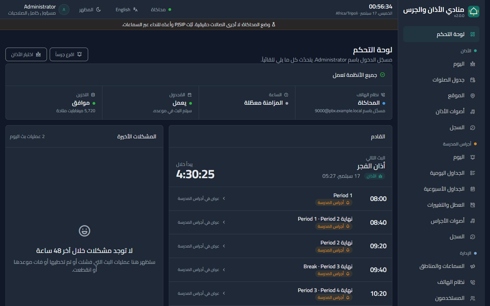
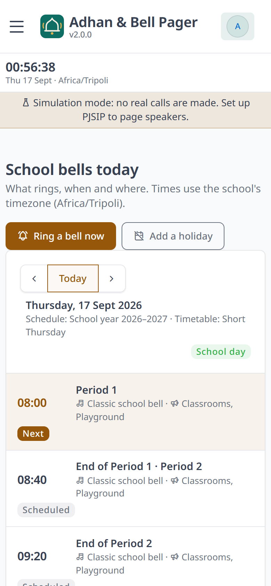

<p align="center">
  
</p>

<h1 align="center">Adhan &amp; Bell Pager</h1>

<p align="center">
  Self-hosted SIP paging for the <b>call to prayer</b> and <b>school bells</b> — on time, on every speaker, in Arabic and English.
</p>

<p align="center" dir="rtl">
  منادي الأذان والجرس: نظام ذاتي الاستضافة لبث الأذان وأجراس المدرسة عبر السنترال الهاتفي
</p>

---

Adhan & Bell Pager calls your PBX extensions, SIP speakers or paging groups and plays the Adhan at prayer times and
school bells from your class timetables. It runs on a small Linux server on your network, needs no cloud service, and
gives each staff member exactly the access they need.

It is the successor of [Adhan Pager](https://github.com/abdlmalekluttee/adhan-pager) 1.7, and existing installations
upgrade in place.



## Features

**Adhan**
- Offline prayer-time calculation (11 methods, Shafi/Hanafi, high-latitude rules) or an imported timetable
- Per-prayer on/off and minute adjustments, optional iqama, per-prayer recordings
- Location by city (offline database) or coordinates

**School Bells**
- Reusable day timetables with periods, breaks, start and end of day, and a period generator
- Weekly schedules with effective dates, holidays, no-bell days and special-day timetables
- Zones, per-bell sounds, play once / repeat / for a set time
- Today view with countdown, two-week outlook, conflict warnings, ring now, test and stop

**Reliable broadcasting**
- One owner of the paging line with a documented priority policy: manual > Adhan > bell
- Every broadcast plays at most once, even across restarts; missed broadcasts are recorded, never played late
- Per-speaker results: answered, busy, no answer, codec, seconds played, RTP packets sent and received
- SIP over UDP, TCP or TLS; G.722, G.711 A-law/µ-law, Opus; bounded registration retries with clear messages

**People and security**
- Roles for Adhan-only, School-Bells-only, operators, viewers and full administrators, plus custom roles
- Server-side permission checks on every action; effective permissions shown with their sources
- Optional Active Directory sign-in with group-to-role mapping (LDAPS/StartTLS)
- Audit log, CSRF protection, strict CSP, encrypted directory credentials, local recovery administrator

**Interface**
- Built on [Tabler](https://github.com/tabler/tabler); dashboard with system health and live broadcast bar
- Complete Arabic (Cairo typeface, right-to-left) and English; light, dark or system theme saved per user
- Works on desktop, tablet and phone; fully offline

## Screenshots

| | |
|---|---|
|  |  |
| School Bells › Today | Timetable editor |
|  |  |
| Adhan › Today | Users and effective permissions |
|  |  |
| Arabic, dark theme | Phone |

## Quick start

Requirements: Linux with Docker and Docker Compose v2, network access to your PBX.

```bash
sudo mkdir -p /opt/adhan-bell-pager && sudo chown "$USER" /opt/adhan-bell-pager
cd /opt/adhan-bell-pager
curl -L https://github.com/abdlmalekluttee/adhan-bell-pager/releases/latest/download/adhan-bell-pager-2.0.0.tar.gz | tar xz --strip-components=1
cp .env.example .env        # set WEB_PORT and TZ
./scripts/install.sh
```

Open `http://<server>:<WEB_PORT>`, sign in as `admin` / `admin`, and set a new password. Then connect the phone system,
add speakers and zones, and set up the Adhan and School Bells. The full walkthrough is in
[docs/DEPLOYMENT.md](docs/DEPLOYMENT.md).

## Documentation

| Topic | |
|---|---|
| Install, configuration, backups, upgrades, rollback, upgrading from v1 | [docs/DEPLOYMENT.md](docs/DEPLOYMENT.md) |
| Setting up school timetables | [docs/SCHOOL_BELLS.md](docs/SCHOOL_BELLS.md) |
| Scheduling rules, priority policy, restarts and missed broadcasts | [docs/SCHEDULING.md](docs/SCHEDULING.md) |
| Users, roles and permissions; recovery administrator | [docs/PERMISSIONS.md](docs/PERMISSIONS.md) |
| Active Directory sign-in | [docs/ACTIVE_DIRECTORY.md](docs/ACTIVE_DIRECTORY.md) |
| Phone system (SIP) setup and troubleshooting | [docs/SIP_TROUBLESHOOTING.md](docs/SIP_TROUBLESHOOTING.md) |
| Security controls and hardening | [docs/SECURITY.md](docs/SECURITY.md) |
| Test strategy and results | [docs/TESTING.md](docs/TESTING.md) |
| UI conventions for contributors | [docs/dev/UI_CONVENTIONS.md](docs/dev/UI_CONVENTIONS.md) |

## Development

```bash
python -m venv .venv && . .venv/bin/activate          # Windows: .venv\Scripts\activate
pip install -r requirements-dev.txt
pytest                                                # 110+ tests, no PBX needed
ruff check app tests scripts

# Run the UI locally with simulated calls and demo data
export CONFIG_PATH=$PWD/demo/config/config.yaml AUDIO_DIR=$PWD/demo/audio
python scripts/seed_demo.py
SIP_SIMULATE=1 WEB_PORT=8931 WEB_BIND=127.0.0.1 python -m app
```

`SIP_SIMULATE=1` replaces PJSIP with a simulator (the UI shows a banner). Real calls need the Docker image, which
compiles PJSIP with the Python bindings.

## License

[PolyForm Noncommercial 1.0.0](LICENSE) — free for noncommercial use, including schools, mosques and other
charitable or educational organisations. Derived from Adhan Pager (Copyright 2026 Adhan Pager Contributors).
Third-party components and their licenses: [THIRD_PARTY_NOTICES.md](THIRD_PARTY_NOTICES.md).

---

<div dir="rtl">

## بالعربية

**منادي الأذان والجرس** يتصل بامتدادات السنترال أو سماعات SIP أو مجموعات النداء، ويبث الأذان في أوقات الصلاة
وأجراس المدرسة حسب الجداول الدراسية. يعمل على خادم Linux صغير داخل الشبكة، دون خدمات سحابية.

### أهم المزايا

- **الأذان:** حساب أوقات الصلاة دون إنترنت أو استيراد جدول، تعديل كل صلاة، الإقامة، ملف صوتي لكل صلاة.
- **أجراس المدرسة:** جداول يومية قابلة لإعادة الاستخدام (حصص، استراحات، بداية ونهاية اليوم)، جدول أسبوعي بتواريخ سريان،
  عطل وأيام دون أجراس وأيام بجدول خاص، مناطق، رنين الآن واختبار وإيقاف، وسجل كامل.
- **بث موثوق:** سياسة أولوية واضحة (يدوي ثم الأذان ثم الجرس)، لا يتكرر أي بث حتى بعد إعادة التشغيل، ولا يُبث متأخراً دون علم.
- **الصلاحيات:** أدوار لمسؤول الأذان فقط أو الأجراس فقط أو المشغل أو المشاهد أو المسؤول الكامل، وأدوار مخصصة،
  وتسجيل دخول اختياري عبر Active Directory، وسجل تدقيق.
- **الواجهة:** مبنية على Tabler، عربية كاملة من اليمين إلى اليسار بخط Cairo، وضع فاتح وداكن، تعمل على الهاتف.

### التثبيت السريع

```bash
./scripts/install.sh
```

ثم افتح `http://<عنوان-الخادم>:<المنفذ>` وسجّل الدخول بـ `admin` / `admin` واختر كلمة مرور جديدة.
التفاصيل في [docs/DEPLOYMENT.md](docs/DEPLOYMENT.md).

</div>
